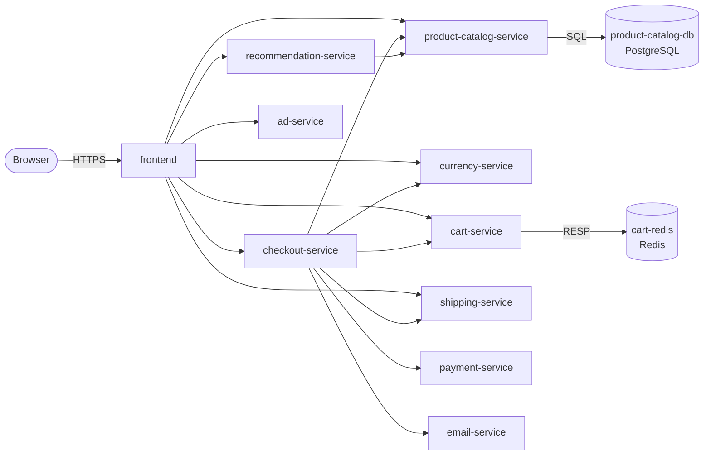

# platform-demo — master reference

A polyglot e-commerce microservices application (an Online-Boutique-style shop) used as the workload of a full platform-engineering project: infrastructure as code on AWS, GitOps, admission control, network security, a developer portal and shared CI/CD.

This page is the **overview**: what the platform is, how it fits together, where everything lives and why it was built this way. The details are in the pages under [`docs/`](docs/index.md) (also rendered in the developer portal) and in the README and `docs/` of each repository; this page links to them instead of repeating them.

## Status

_Written on 2026-10-23._

- **Merged, not deployed.** Every repository of the organisation is on `main` and the AWS platform is described completely in code: Terraform, the Helm charts, the GitOps layers, the policies and the portal. **No cluster has been created from it yet, so nothing described below has been verified on a live EKS cluster.** Statements about runtime behaviour (mutual authentication, gVisor, encryption, admission, sign-in) are the design, checked in CI by rendering, linting, schema validation and policy tests, not observed results.
- **Next step:** run the Deploy workflow of `infra-terraform`, then verify and fix what a real cluster shows. The known first-deploy risks and the verification checklist are in [Next steps](docs/next-steps.md), in the [infrastructure documentation](https://github.com/platform-boutique/infra-terraform/tree/main/docs) and in the Helm repository's [`gitops/README.md`](https://github.com/platform-boutique/platform-demo-helm/blob/main/gitops/README.md).
- **Not part of the platform yet:** a monitoring stack on the cluster (the services still export OTLP to an Alloy that is not deployed, so they only log exporter errors), TechDocs publishing for the portal, and automatic promotion of new image digests into the Helm repository.

## Contents

1. [The platform at a glance](#1-the-platform-at-a-glance)
2. [The shop](#2-the-shop)
3. [Infrastructure on AWS](#3-infrastructure-on-aws)
4. [GitOps: how the cluster is filled](#4-gitops-how-the-cluster-is-filled)
5. [Security model](#5-security-model)
6. [Secrets and the database](#6-secrets-and-the-database)
7. [Developer portal and sign-in](#7-developer-portal-and-sign-in)
8. [CI/CD, branching and releases](#8-cicd-branching-and-releases)
9. [Repository map](#9-repository-map)
10. [Decisions and why](#10-decisions-and-why)
11. [Next steps](#11-next-steps)
12. [Where to read more](#12-where-to-read-more)

---

## 1. The platform at a glance

| Item | Value |
|---|---|
| Cloud | AWS, region `us-east-1`; every AWS resource is created and destroyed by Terraform (Kubernetes creates none) |
| Cluster | EKS `platform-demo`, Spot worker nodes (Amazon Linux 2023) in two zones, gVisor as a second container runtime |
| Network layer | Cilium as the only CNI (overlay, kube-proxy replacement), SPIFFE/SPIRE mutual authentication, WireGuard encryption, Hubble, Gateway API |
| Entry point | An ALB owned by Terraform: TLS ends there (ACM certificate for `platform-demo.click` and `*.platform-demo.click`), plain HTTP to port 8080 on the nodes, where the Cilium Gateway listens |
| Hostnames | `shop`, `argocd`, `backstage`, `dex`, `hubble`, `grafana` under `platform-demo.click` (Route 53 alias records to the ALB); the ALB admits only the addresses listed in the `ALB_ALLOWED_CIDRS` repository variable |
| Delivery | Argo CD, app of apps from `platform-demo-helm` (`main`); Terraform installs only Argo CD and the root Application |
| Admission | Kyverno (CEL policies), enforcing, including cosign signature verification |
| Secrets | AWS Systems Manager Parameter Store and Secrets Manager, synced by the External Secrets Operator; nothing secret in Git or in Terraform state |
| Database | Multi-AZ RDS PostgreSQL for the developer portal; the shop keeps its own PostgreSQL and Redis as StatefulSets |
| Portal | Backstage on `backstage.platform-demo.click`, signing in with GitHub through Dex |
| CI/CD | Reusable GitHub Actions workflows (`platform-demo-workflows`); images built, scanned, signed and published to Docker Hub; trunk-based releases by semver tag |

```
internet --:443--> ALB (TLS ends) --:8080--> EKS nodes (private subnets, Spot) --> Cilium Gateway --> Services --> Pods
                                                      \-- 2 NAT gateways (one per zone) for everything outbound

 service repos --release tag--> Docker Hub (signed image, digest)
        platform-demo-helm (main): charts + envs/ + gitops/ + policies/  <--- Argo CD pulls ---  EKS
        infra-terraform: VPC, EKS, Cilium, nodes, ALB, DNS, RDS, IAM     <--- Deploy workflow ---  GitHub Actions (OIDC)
```

---

## 2. The shop

Ten services (`frontend` plus nine backends) and two data stores. Only `frontend` is reachable from outside; everything else talks gRPC over HTTP/2 inside the cluster. The shop is the workload, not the point of the project: it is deliberately simple, but polyglot and observable.



| Service | Language | Role |
|---|---|---|
| frontend | Go | storefront, session cookie, fans out to seven backends |
| product-catalog-service | Go | product reads from PostgreSQL |
| checkout-service | Go | orchestrates `PlaceOrder` across six services |
| shipping-service | Go | flat quote, fake tracking id |
| cart-service | C# / .NET | carts in Redis |
| currency-service, payment-service | TypeScript / Node | static rates; simulated card validation |
| email-service, recommendation-service | Python | email stub; random picks |
| ad-service | Java | contextual ads |

Things that shape the platform (the full list is in [Gotchas](docs/gotchas.md)): the frontend's cookies are `Secure`, so the shop needs HTTPS; each gRPC client pins to one backend pod, so extra replicas get little traffic without an L7 balancer; `product-catalog-service` exits when its database is not up (the chart waits for it); three Go services run as root in their images and are `amd64` only (the charts override the user); `payment-service` logs full card data (test cards only).

Details: [System at a glance](docs/system.md) · [Architecture and request flows](docs/architecture.md) · [Service inventory](docs/services.md) · [Container images](docs/images.md) · [Service wiring](docs/wiring.md) · [Observability contract](docs/observability.md) · [Kubernetes translation guide](docs/kubernetes.md) · [Helm charts](docs/helm.md) · [Local stack (docker compose)](docs/local-stack.md) · [OTLP migration](docs/otlp-migration.md).

All services share the protobuf package `hipstershop` (the Online Boutique heritage) and keep their own copy of the `.proto` files they use.

---

## 3. Infrastructure on AWS

Repository [`infra-terraform`](https://github.com/platform-boutique/infra-terraform) (README and `docs/` there). Three stacks with separate state, split by how long their contents live:

| Stack | Contains | Applied by |
|---|---|---|
| `bootstrap` | state bucket and key, GitHub OIDC provider, the pipeline's plan and apply roles | a person, once (`scripts/bootstrap.sh`) |
| `foundation` | the ACM certificate | the Foundation workflow |
| `platform` | network, EKS, Cilium, nodes, gp3 StorageClass, Argo CD bootstrap, ALB, DNS records, RDS, the External Secrets role | the Deploy and Destroy workflows |

Destroying the platform therefore never touches the state, the roles, the hosted zone or the certificate, and the platform can be rebuilt and torn down to stop the cost.

The platform stack is composed of modules that run in a fixed order (the order is the reason there are several): `network` (VPC, two public and two private /24 subnets, a NAT gateway per zone) -> `eks-cluster` (control plane, no add-ons) -> `cilium` (Gateway API CRDs, Cilium with SPIRE and WireGuard; before the nodes, because a node is not Ready without a CNI) -> `eks-nodes` (Spot node group, gVisor, CoreDNS, EBS CSI driver) -> `storage-class` (default gp3) -> `argocd-bootstrap` (Argo CD and the root Application). `alb`, `dns`, `database` and `secrets-access` are independent of that chain.

- **ALB and Gateway.** The Cilium Gateway runs in host-network mode and creates no `LoadBalancer` Service, so no cloud controller makes AWS resources behind Terraform's back. Targets are the nodes (the pod network is an overlay the VPC does not route). See [the ALB and the Gateway](https://github.com/platform-boutique/infra-terraform/blob/main/docs/alb-and-gateway.md).
- **Webhooks on the host network.** Because the pod CIDR is not routed in the VPC, the EKS control plane cannot reach admission webhooks in pods; Kyverno and the External Secrets Operator therefore run their webhook servers on the host network.
- **gVisor.** Installed on every node by a checksum-verified boot script and registered with containerd; used through the RuntimeClass `gvisor`. See [gVisor](https://github.com/platform-boutique/infra-terraform/blob/main/docs/gvisor.md).
- **Pipeline.** Plan on every pull request (read-only role); Deploy and Destroy are manual workflows that plan, show the reason and the changes on the run page, wait for approval in a protected GitHub environment and apply exactly the reviewed plan. AWS access is through GitHub OIDC roles only, no stored keys. See [Pipeline](https://github.com/platform-boutique/infra-terraform/blob/main/docs/pipeline.md) and [Operations](https://github.com/platform-boutique/infra-terraform/blob/main/docs/operations.md).

All values of the environment are in one committed file per stack (`stacks/<stack>/<stack>.auto.tfvars`); modules have no environment defaults.

---

## 4. GitOps: how the cluster is filled

Repository [`platform-demo-helm`](https://github.com/platform-boutique/platform-demo-helm) (README, `gitops/README.md`, `docs/`). It holds the charts (a `platform-common` library chart, one thin chart per workload, the Gateway, Dex, Backstage), `envs/<env>/` (what runs where) and `gitops/` (Argo CD's own configuration).

Terraform stops after installing Argo CD (bootstrap values only) and the Application `platform-root`. From there Git owns everything, as an **app of apps in four layers**, ordered by sync waves:

| Layer | Contents |
|---|---|
| bootstrap | namespaces with their Pod Security, Kyverno and gVisor labels, the RuntimeClass, a one-off Job that restarts Cilium once SPIRE is running |
| security | External Secrets Operator and its configuration, Reloader, Kyverno, the policies |
| platform | network policies, the Gateway and routes, Dex, Backstage, Argo CD managing itself |
| workloads | the shop (ApplicationSet from `envs/dev/workloads.yaml`) |

Adding an app is one line in `envs/dev/workloads.yaml` or `addons.yaml` plus its namespace in `envs/dev/values/cluster-bootstrap.yaml` (CI checks both). **Promotion is a pull request** that changes `image.digest` in `envs/<env>/values/<app>.yaml`; the Helm CI renders every app exactly as Argo CD will, validates it and verifies that the digest is pinned and signed. Details, waves, projects and the first-boot sequence: [`gitops/README.md`](https://github.com/platform-boutique/platform-demo-helm/blob/main/gitops/README.md) and the Helm repository's `docs/`.

Terraform and Argo CD share Argo CD's own release and the `platform-admin` project on purpose (Terraform to start, Git to own); how they are kept from fighting is in the infrastructure [Architecture](https://github.com/platform-boutique/infra-terraform/blob/main/docs/architecture.md) page.

---

## 5. Security model

Layers, from the network inwards. Each is defined in code; none has been observed on a live cluster yet (see Status).

| Layer | What | Where |
|---|---|---|
| Edge | TLS at the ALB; ALB security groups admit only the configured addresses; WAF is a follow-up | `infra-terraform` |
| Node and cluster | IMDSv2 with hop limit 1, API endpoint IAM-authenticated, explicit admin and viewer identities | `infra-terraform` |
| Pod network | Cilium default-deny `CiliumNetworkPolicy` on every workload and platform namespace; between shop services every rule requires **mutual authentication** (SPIFFE/SPIRE); **WireGuard** encrypts node-to-node traffic | `platform-common`, `platform-network-policies`, `modules/cilium` |
| Workload isolation | Pod Security `restricted` for the shop (labels from one place, `cluster-bootstrap`); non-root, read-only root filesystem, no capabilities, seccomp, no API token; **gVisor** (`runsc`) for namespaces labelled `platform.demo/sandbox=gvisor` (shop, backstage, sso), applied by a Kyverno mutation | charts, `cluster-bootstrap`, `policies/` |
| Admission | Kyverno: pod identity (the label Cilium trusts cannot be forged or changed), image sources, digests, never `:latest`, cosign signature verification, read-only root, resources, probes, service types and route hostnames, protected network policy objects, no `kubectl exec` without a break-glass annotation | [`policies/README.md`](https://github.com/platform-boutique/platform-demo-helm/blob/main/policies/README.md) |
| Supply chain | Images built once, Trivy-scanned, copied (not rebuilt) to Docker Hub, cosign-signed keyless with an SBOM attestation; every action pinned by commit SHA; immutable release tags | `platform-demo-workflows`, each repo |
| Secrets | Not in Git or in Terraform state; read at runtime through External Secrets with an IAM role limited to one parameter prefix | section 6 |
| Delivery | Pull-based: no pipeline holds cluster credentials; the apply role is assumable only from protected GitHub environments on `main` | `infra-terraform`, GitOps |

Known limits that are accepted and written down: mutual authentication is a Cilium beta feature that authenticates but does not encrypt (WireGuard does that), and identity is label-derived (hence the Kyverno identity policy); the EKS API endpoint is public but IAM-authenticated; the Docker Hub pull limit can affect signature verification, which is why a read-only token is used.

---

## 6. Secrets and the database

- **Typed secrets** (the GitHub OAuth App for Dex, a GitHub token for the portal, a read-only Docker Hub token for Kyverno, the generated client secrets between Dex and its clients, the shop database password) are created once as SecureString parameters under `/platform-demo/` in Parameter Store. Terraform never writes them, so they are in no state file and survive every `terraform destroy`. The table of parameters and their consumers is in the infrastructure [Secrets](https://github.com/platform-boutique/infra-terraform/blob/main/docs/secrets.md) page and the Helm repository's `docs/secrets.md`.
- **External Secrets Operator** reads them (and the RDS-managed password from Secrets Manager) into Kubernetes Secrets. Its service account is created by Terraform because the role annotation contains the AWS account id, which a public repository must not hold. Reloader restarts the portal when its rotated database password changes.
- **The portal's database** is a Multi-AZ RDS PostgreSQL instance in the private subnets, encrypted with KMS, TLS forced, reachable only from the nodes' security group. RDS generates and rotates the master password; it never passes through Terraform or Git.
- **The shop's database** stays a StatefulSet (`product-catalog-db`, with the Redis for carts). This is a deliberate choice: the shop is expected to move to its own cluster, and `envs/dev/workloads.yaml` already has a `cluster:` field for that.
- Sealed Secrets was rejected: the cluster is rebuilt often and its decryption key would be lost each time.

---

## 7. Developer portal and sign-in

Repository [`platform-demo-backstage`](https://github.com/platform-boutique/platform-demo-backstage) (README and `docs/`, rendered in the portal itself): a Backstage instance with the software catalog (discovered from `catalog-info.yaml` in every repository), TechDocs and views of Kubernetes, Argo CD, Kyverno policy reports, network flows and releases. Four plugins live in their own repositories (`platform-demo-backstage-plugin-hubble`, `-releases`, `-policies`, `-argocd`). It runs on EKS, stores its data in RDS and is released as a signed image by the same pipeline as the services.

**Single sign-on** is [Dex](https://dexidp.io) with GitHub as the identity provider, for the portal, Argo CD and (when deployed) Grafana. Argo CD's local `admin` account is disabled in Git and in the bootstrap install, so no password exists; the break-glass path is `argocd --core` with the person's own IAM identity. The GitHub OAuth App's callback is `https://dex.platform-demo.click/callback`. Details: the portal's [Single sign-on](https://github.com/platform-boutique/platform-demo-backstage/blob/main/docs/sso.md) page and the Helm repository's `docs/sso-and-portal.md`.

---

## 8. CI/CD, branching and releases

**Model: trunk-based.** `main` is the trunk; work happens on short-lived `feat/*`, `fix/*`, `docs/*`, `chore/*` branches merged by squash pull request. There is no production branch: a release is an annotated semver tag `vX.Y.Z` on `main`, and environments are directories in `platform-demo-helm`.

**Pipelines never run on push.** `ci.yaml` runs on pull requests, `release.yaml` on a `v*` tag or manual dispatch. Both are thin callers of the reusable workflows in [`platform-demo-workflows`](https://github.com/platform-boutique/platform-demo-workflows#readme), pinned by commit SHA with explicit per-job permissions.

| Stage | What happens |
|---|---|
| language gates | format and lint, secret scan, build, unit tests, dependency audit (SCA), static analysis (SAST) for Go, Node, Python, Java and .NET |
| image | build once, stage on ghcr.io, Trivy-scan that exact digest (HIGH and CRITICAL fail) |
| release (tag only) | refuse commits not on `main`; copy the scanned digest to Docker Hub without rebuilding; tags `:X.Y.Z`, `:sha-<short>`, `:latest`; cosign keyless signature and signed SBOM attestation, each self-verified |
| Terraform | `fmt`/`validate`, TFLint, Trivy, Checkov, cost estimate and a plan comment on pull requests; Deploy and Destroy plan, wait for approval in a protected environment and apply exactly the reviewed plan |
| Helm repository | lint and render of every chart and of every app of every environment exactly as Argo CD renders it, strict schema validation, Trivy config scan, a cosign gate on every deployed image, and the Kyverno policy tests |

**Guardrails:** branch protection on `main` in every repository (pull request and required checks, linear history, no force-push or deletion, enforced for administrators), immutable `v*` tags, GitHub secret scanning with push protection, CODEOWNERS, Dependabot (monthly, grouped, majors left to deliberate upgrades) and local `pre-commit` hooks (`pipx install pre-commit && pre-commit install`; gitleaks on the staged diff). Every action is pinned to a release at least a week old.

**Delivery** is pull-based (section 4). The link between the two halves, a pull request in `platform-demo-helm` opened automatically when a service is released, is designed but not built; today the digest is bumped by hand. Details and the release model: [CI/CD, branching and releases](docs/cicd.md) and the workflows repository's README.

---

## 9. Repository map

All repositories are in the GitHub organisation [`platform-boutique`](https://github.com/platform-boutique). An organisation has no folders, so the category is in the name (`app-<service>`, `infra-<name>`, `platform-demo-<name>`) and in the custom property `category`; the organisation front page (`.github`, `profile/README.md`) lists them by category. Roadmap: the organisation's [project board](https://github.com/orgs/platform-boutique/projects/1).

| Group | Repository | Contents |
|---|---|---|
| apps | `app-frontend`, `app-ad-service`, `app-cart-service`, `app-checkout-service`, `app-currency-service`, `app-email-service`, `app-payment-service`, `app-product-catalog-service`, `app-recommendation-service`, `app-shipping-service` | the ten services, each with thin CI and release callers |
| apps | `app-product-catalog-db` | PostgreSQL image with schema and seed data (the shop's database) |
| infra | [`infra-terraform`](https://github.com/platform-boutique/infra-terraform) | the AWS environment (section 3) |
| deploy | [`platform-demo-helm`](https://github.com/platform-boutique/platform-demo-helm) | charts, `envs/`, `gitops/`, `policies/` (section 4) |
| platform | [`platform-demo-workflows`](https://github.com/platform-boutique/platform-demo-workflows) | reusable GitHub Actions workflows and the generators in `tools/` |
| platform | [`platform-demo-backstage`](https://github.com/platform-boutique/platform-demo-backstage) and its four plugins | the developer portal (section 7) |
| platform | [`platform-demo-observability`](https://github.com/platform-boutique/platform-demo-observability) | the docker-compose observability stack and the Alloy pipeline for the OTLP setup |
| docs | [`platform-demo-docs`](https://github.com/platform-boutique/platform-demo-docs) | this page and `docs/` |

Local workspace layout: the repositories are cloned side by side under `apps/`, `deploy/`, `platform/`, `infra/` and `docs/` (the folder under `apps/` is the repository name without the `app-` prefix). A new service goes in `apps/<name>` plus one line in the Helm repository's `envs/<env>/workloads.yaml`; anything that provisions cloud or cluster resources goes in `infra/`; environment state lives only in `deploy/platform-demo-helm/envs/`. Full table with links: [Repository map](docs/repositories.md).

---

## 10. Decisions and why

| Decision | Why |
|---|---|
| Terraform owns every AWS resource, including the ALB; Kubernetes owns none | nothing is left behind after a destroy and no cloud controller needs permissions |
| Cilium as the only CNI, overlay mode, Gateway API in host-network mode | one component for networking, policy, mutual authentication, encryption, flow visibility and ingress; pods need no VPC addresses |
| Terraform installs only Argo CD and the root Application | Argo CD cannot install itself on nodes that do not exist; everything else is reviewed in Git |
| App of apps in four layers with sync waves | secrets, policies and namespaces must exist before the workloads that need them |
| Spot nodes on Amazon Linux 2023 | cost; AL2023 is kept because gVisor is installed by a boot script (Bottlerocket would drop it) |
| gVisor for the shop, portal and Dex; not for Argo CD, Kyverno, External Secrets | sandbox the application tier; webhooks need the host network and Argo CD is the recovery path |
| Kyverno CEL policy types, enforcing, signature verification on | pod identity, supply chain and hardening cannot be expressed in Pod Security or Cilium |
| Promotion is a pull request on a digest | the signed image, the render and the policy tests are checked before anything reaches an environment |
| Secrets in Parameter Store and Secrets Manager, synced at runtime | nothing secret in Git or state; survives rebuilds, unlike Sealed Secrets |
| Portal database on RDS, shop database kept as StatefulSets | the portal must outlive cluster rebuilds; the shop is expected to move to another cluster |
| Trunk-based, tags for releases, no pipeline on push | one place to review, nothing publishes by accident, release tags are immutable |
| Pipelines in reusable workflows, callers pinned by SHA | a fix lands once and a caller cannot get more permissions than it grants |

---

## 11. Next steps

The prioritised list, with context, is in [Next steps](docs/next-steps.md). In short:

1. Run the first Deploy of `infra-terraform`, then verify and debug on the live cluster (Cilium encryption and mutual authentication, gVisor, webhooks, the sync order, secrets, sign-in).
2. Build the automatic promotion of released images into `platform-demo-helm`, then add further environments.
3. Decide on telemetry for the shop (deploy a collector or switch OTLP export off) and publish TechDocs from CI.
4. Security follow-ups: WAF on the ALB, backups, short-lived credentials and MFA for the Terraform user, a budget alarm.
5. Remove the remaining references to the old local-cluster hostnames from the service repositories.

---

## 12. Where to read more

| Question | Page |
|---|---|
| What are the services, ports, images, who calls whom? | [System](docs/system.md), [Services](docs/services.md), [Images](docs/images.md), [Wiring](docs/wiring.md) |
| How does telemetry work? | [Observability contract](docs/observability.md), [OTLP migration](docs/otlp-migration.md) |
| How does the shop map onto Kubernetes and Helm? | [Kubernetes](docs/kubernetes.md), [Helm](docs/helm.md) |
| What goes wrong? | [Gotchas](docs/gotchas.md) |
| How do I run it on a laptop? | [Local stack](docs/local-stack.md) |
| How is it built and released? | [CI/CD](docs/cicd.md) |
| How is AWS set up? | [`infra-terraform` documentation](https://github.com/platform-boutique/infra-terraform/tree/main/docs) |
| How does Argo CD deploy it, and the policies? | [`gitops/README.md`](https://github.com/platform-boutique/platform-demo-helm/blob/main/gitops/README.md), [`policies/README.md`](https://github.com/platform-boutique/platform-demo-helm/blob/main/policies/README.md) |
| How does the portal work? | [`platform-demo-backstage` documentation](https://github.com/platform-boutique/platform-demo-backstage/tree/main/docs) |
