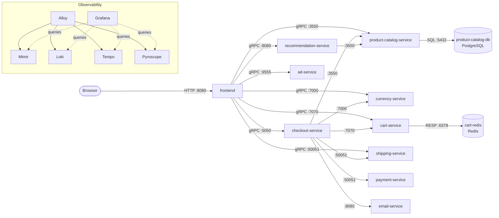

# Architecture and request flows

Leaf services (no outbound calls): `ad`, `currency`, `payment`, `email`, `shipping`. Data stores sit behind `product-catalog-service` and `cart-service` only — nothing else talks to them.

### Browse / add to cart

1. Browser → `frontend` `GET /`. The frontend sets a `shop_session-id` cookie (random UUID, used as the cart `user_id`).
2. In parallel: `currency.GetSupportedCurrencies`, `product-catalog.ListProducts`, `cart.GetCart`; then `currency.Convert` per product; `ad.GetAds` (100 ms deadline, failure ignored).
3. Product page adds `recommendation.ListRecommendations` → `product-catalog.ListProducts` (inside the recommendation service) → up to 4 `product-catalog.GetProduct`.
4. "Add to cart" → `POST /cart` → `cart.AddItem` (Redis write).

### Checkout

`POST /cart/checkout` → `frontend` validates the form → `checkout.PlaceOrder`:

1. `cart.GetCart` → per item (parallel) `product-catalog.GetProduct` + `currency.Convert` → `shipping.GetQuote` + `currency.Convert`
2. `payment.Charge` (fail → abort)
3. `shipping.ShipOrder` (fail → error; card already charged — **no rollback**)
4. `cart.EmptyCart` (error ignored)
5. `email.SendOrderConfirmation` (error logged, order still succeeds)

Trace context (W3C `traceparent`) is generated at the frontend and propagated through every gRPC hop, so one checkout produces one trace spanning up to 8 services.

---
