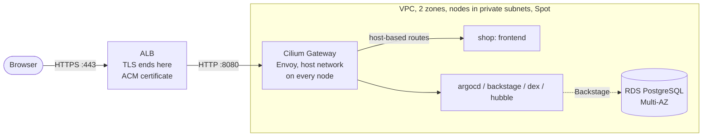
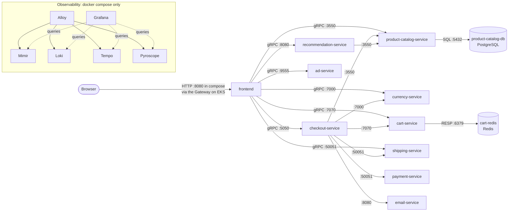

# Architecture and request flows

## Where it runs

The target is AWS EKS. Terraform owns every AWS resource; Kubernetes creates none (no Service of type `LoadBalancer`, no Ingress). Design and reasons are in the infra repository: [Architecture](https://github.com/platform-boutique/infra-terraform/blob/main/docs/architecture.md) and [The ALB and the Gateway](https://github.com/platform-boutique/infra-terraform/blob/main/docs/alb-and-gateway.md).

- **Entry.** `shop.`, `argocd.`, `backstage.`, `dex.` and `hubble.platform-demo.click` are alias records pointing at the ALB. The ALB targets the *nodes* (pod addresses are not routable in the VPC) on port 8080; the Gateway selects the backend by host name. Port 80 only redirects to 443. The ALB admits only an address allow-list, so every UI is private to those addresses.
- **Between pods.** Cilium (overlay, no kube-proxy) enforces default-deny network policy. Between shop workloads every allowed rule additionally requires **SPIFFE/SPIRE mutual authentication**; **WireGuard** encrypts traffic between nodes. The Gateway is the one thing never asked to authenticate (it has no SPIFFE identity).
- **Pod isolation.** The shop, Backstage and Dex run in gVisor (`runtimeClassName: gvisor`, applied by a Kyverno mutation from a namespace label). Argo CD, Kyverno, External Secrets and other host-network or system components do not.
- **Data.** Backstage keeps its catalog in a Multi-AZ RDS (TLS forced, reachable only from the nodes' security group, master password generated and rotated by RDS). The shop's PostgreSQL and Redis are StatefulSets on `gp3` EBS volumes.
- **Deployment.** Terraform installs Cilium, the nodes, the `gp3` StorageClass and Argo CD with a root Application. From there Git (`platform-demo-helm`) is the only source of truth; see [Helm charts](helm.md#88-the-eks-platform-argo-cd-layers).
- **No monitoring stack** runs on the cluster for now, so the OTLP target below does not exist there.

!!! warning "Status"
    All of this is merged but **has not been deployed yet**. Known first-deploy risks (WireGuard on the node kernel, the SPIRE start order, gVisor with Cilium, Argo CD adopting its own release) are listed in the owning repositories: [infra-terraform architecture](https://github.com/platform-boutique/infra-terraform/blob/main/docs/architecture.md#risks-of-the-first-deploy-with-these-settings) and the "Mutual authentication" and gVisor sections of [`gitops/README.md`](https://github.com/platform-boutique/platform-demo-helm/blob/main/gitops/README.md).

## How the services talk

The service graph is the same everywhere (compose and cluster). The observability box exists only in the docker compose stack.

Leaf services (no outbound calls): `ad`, `currency`, `payment`, `email`, `shipping`. Data stores sit behind `product-catalog-service` and `cart-service` only — nothing else talks to them.

### Browse / add to cart

1. Browser → `frontend` `GET /`. The frontend sets a `shop_session-id` cookie (random UUID, used as the cart `user_id`).
2. In parallel: `currency.GetSupportedCurrencies`, `product-catalog.ListProducts`, `cart.GetCart`; then `currency.Convert` per product; `ad.GetAds` (100 ms deadline, failure ignored).
3. Product page adds `recommendation.ListRecommendations` → `product-catalog.ListProducts` (inside the recommendation service) → up to 4 `product-catalog.GetProduct`.
4. "Add to cart" → `POST /cart` → `cart.AddItem` (Redis write).

### Checkout

`POST /cart/checkout` → `frontend` validates the form → `checkout.PlaceOrder`:

1. `cart.GetCart` → per item (parallel) `product-catalog.GetProduct` + `currency.Convert` → `shipping.GetQuote` + `currency.Convert`
2. `payment.Charge` (fail → abort)
3. `shipping.ShipOrder` (fail → error; card already charged — **no rollback**)
4. `cart.EmptyCart` (error ignored)
5. `email.SendOrderConfirmation` (error logged, order still succeeds)

Trace context (W3C `traceparent`) is generated at the frontend and propagated through every gRPC hop, so one checkout produces one trace spanning up to 8 services.

---
